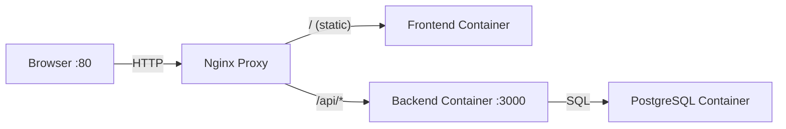
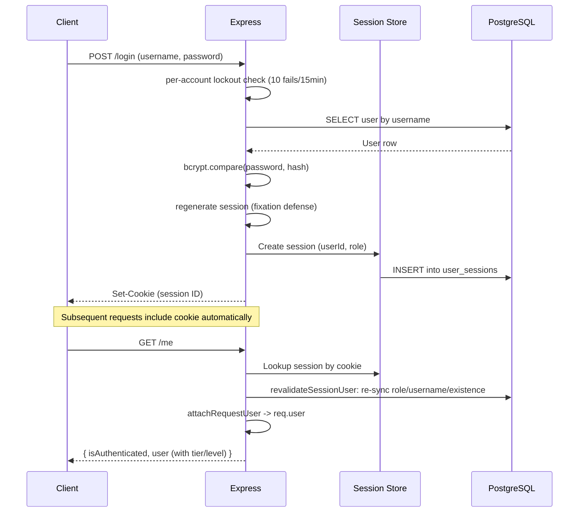
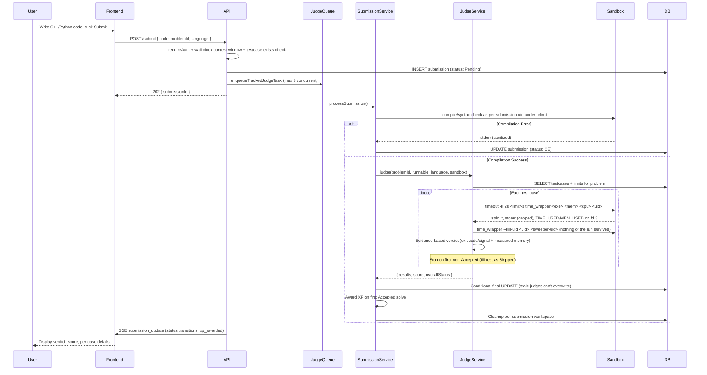
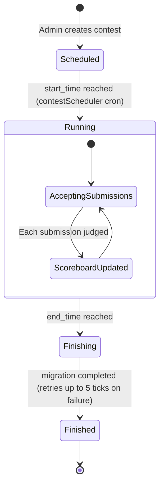
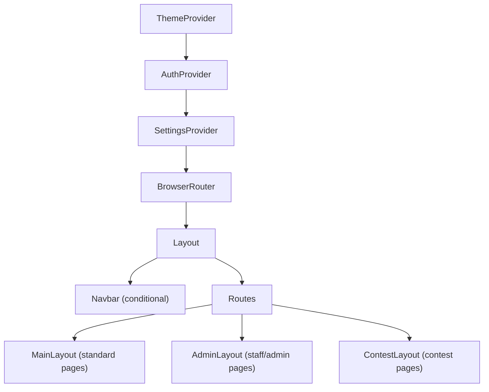

# Architecture — OJ Grader System

> The physical and logical map of the system.

## Tech Stack

| Layer | Technology | Version |
|---|---|---|
| Frontend | React (Vite) | 19.1 |
| Routing | react-router-dom | 7.8 |
| HTTP Client | Axios | 1.11 |
| Charts | recharts | 3.10 |
| Code Editor | react-simple-code-editor | 0.14 |
| Syntax Highlight | highlight.js | 11.11 |
| Backend | Express | 5.3 |
| Database | PostgreSQL (Alpine) | 16 |
| Session Store | connect-pg-simple | 10.0 |
| Rate Limiting | express-rate-limit | 8.7 |
| Auth (passwords) | bcrypt | 6.0 |
| Validation | zod | 4.x |
| File Upload | multer | 2.5 |
| Image Processing | sharp | 0.35 |
| ZIP Processing | unzipper | 0.12 |
| Scheduling | node-cron | 4.6 |
| Reverse Proxy | Nginx | 1.30 |
| Containerization | Docker + Compose | — |
| Testing (BE) | Jest 30 + Supertest 7 | — |
| Testing (FE) | Jest + React Testing Library 16 | — |
| Testing (visual) | Playwright | 1.63 |
| Language | TypeScript (backend + frontend) | — |
| Judged Languages | C++ (compiled) and Python (stdlib-only interpreter), executed in an isolated per-submission sandbox | — |

## System Hierarchy

```
OJ/
├── .context/               # AI context documentation (this directory)
├── .env / .env.example     # Environment configuration
├── docker-compose.yml      # Orchestrates the stack (database, migrate one-shot,
│                           #   backend, authoring-runner, frontend, nginx-proxy)
├── nginx-proxy/            # Nginx reverse proxy config
│
├── backend/                # Express API server (TypeScript)
│   ├── server.ts           # Entry: createApp, startup submission sweep, scheduler start
│   ├── app.ts              # Express app factory: middleware order, router mounting
│   ├── db.ts               # pg Pool (max 20, statement_timeout 60s) + withTransaction
│   ├── config/
│   │   └── env.ts          # Runtime env validation (zod) + typed env export
│   ├── constants/
│   │   ├── index.ts        # Centralized constants (roles, statuses, limits, rate limits)
│   │   └── progression.ts  # XP / level / tier progression constants
│   ├── controllers/        # Route handlers (Express Router per domain)
│   │   ├── authController.ts
│   │   ├── adminController.ts
│   │   ├── problemController.ts
│   │   ├── submissionController.ts
│   │   ├── contestController.ts
│   │   ├── analyticsController.ts      # Admin analysis tab
│   │   ├── healthController.ts
│   │   ├── realtimeController.ts       # SSE submission/scoreboard streams
│   │   ├── userProfileController.ts    # Public profiles, avatars, password change
│   │   ├── authorProfileController.ts  # Author identity API
│   │   └── authoring*.ts               # Draft/job/testcase/workspace authoring API
│   ├── services/           # Business logic & external processes
│   │   ├── judgeService.ts       # Judge C++/Python in per-submission sandbox
│   │   ├── judgeQueue.ts         # Concurrency gate + in-flight registry + contest drain
│   │   ├── submissionService.ts  # Submission pipeline + startup orphan sweep
│   │   ├── submissionQueryService.ts # Submission read/queue/query orchestration
│   │   ├── rejudgeService.ts     # Batch rejudge (problem/contest scope)
│   │   ├── progressionService.ts # XP/level/tier/rank derivation and awarding
│   │   ├── siteSettingsService.ts # system_settings access (access mode, toggles)
│   │   ├── maintenanceMode.ts    # Import-time 503 gate + scheduler pause
│   │   ├── similarityService.ts  # Contest cheat detection
│   │   ├── adminQueryService.ts  # Admin user/settings query orchestration
│   │   ├── adminDatabaseService.ts # Database import/export jobs + progress
│   │   ├── problemQueryService.ts # Problem CRUD/upload/export/testcase-viewer
│   │   ├── collectionQueryService.ts # Collections CRUD + bulk visibility
│   │   ├── batchUploadService.ts # Bulk problem import from ZIP
│   │   ├── problemMigration.ts   # Contest attach/detach + post-contest migration
│   │   ├── contestQueryService.ts # Contest list/detail/join orchestration
│   │   ├── contestScoreboardQueryService.ts # Scoreboard variants by status
│   │   ├── contestParticipantQueryService.ts # Participant-gated problem access
│   │   ├── contestAccess.ts      # Shared contest role/visibility predicates
│   │   ├── contestScheduler.ts   # Cron-based contest lifecycle (retries, drain)
│   │   ├── realtimeHub.ts        # In-process pub/sub for SSE events
│   │   ├── authoring*/ts         # Authoring workspace services (drafts, jobs, publish, ...)
│   │   └── userAvatarImageService.ts / userProfileQueryService.ts
│   ├── middleware/
│   │   ├── auth.ts         # requireAuth, requireStaffOrAdmin, requireAdmin (req.user only)
│   │   ├── requestContext.ts # revalidateSessionUser + attachRequestUser
│   │   ├── rateLimit.ts    # General/auth/submit limiters + login lockout
│   │   ├── siteAccess.ts   # requirePublicAccess (PUBLIC/PRIVATE mode gate)
│   │   ├── validation.ts   # zod runtime request validation middleware
│   │   ├── errorHandler.ts # asyncHandler + AppError + global error middleware
│   │   └── upload.ts       # Multer configuration (2 GiB disk, 25/64 MiB problem-route memory caps, 10 MiB images)
│   ├── schemas/
│   │   └── requestSchemas.ts # Shared z.object request schemas (all controllers)
│   ├── utils/
│   │   ├── sandboxProcess.ts  # Shell-less bounded child runner + sandbox identities
│   │   ├── compileGuard.ts    # Pre-compile guards on a GCC-faithful pp-token lexer: forbidden includes / #line / #embed; header-problem source rules
│   │   ├── dbErrors.ts        # isUniqueViolation (Postgres 23505 -> 409)
│   │   ├── csv.ts             # RFC 4180 serialisation + formula-injection guard
│   │   ├── errorMessage.ts    # Unknown->message error normalization helper
│   │   └── logger.ts          # Structured logger (JSON in prod)
│   ├── scripts/
│   │   ├── init_db.ts      # Destructive dev reset (DROP CASCADE + CREATE)
│   │   ├── migrate.ts      # Non-destructive migration runner (advisory lock)
│   │   ├── create_admin.ts # Interactive admin user setup
│   │   ├── backfill_xp.ts  # Backfill user_problem_rewards from history
│   │   ├── seed_xp_tiers.ts # Demo seeder for progression UI review
│   │   ├── verifyHotfix.ts # Sandbox workspace-ownership verification
│   │   ├── clear_submissions.ts
│   │   └── time_wrapper.c  # C wrapper: timing, rlimits, privilege drop, seccomp
│   ├── types/              # Type definitions and interfaces
│   │   ├── api.ts          # Request/response DTO contracts
│   │   ├── models.ts       # DB row interfaces + shared DTO aliases
│   │   ├── service.ts      # Shared service-layer interfaces/result unions
│   │   ├── env.d.ts        # ProcessEnv declaration merging
│   │   └── express/        # Express Request declaration merging (req.user)
│   └── tests/              # Jest + Supertest API and Unit tests (TypeScript)
│       ├── setup.ts        # Test environment setup (global pg mock)
│       ├── authController.test.ts, ... # Controller tests
│       ├── services/       # Mock-heavy unit tests for business logic
│       ├── middleware/     # Middleware tests
│       └── integration/    # Real-PostgreSQL authoring suites
│
├── frontend/               # React SPA (Vite)
│   └── src/
│       ├── App.tsx         # Root component, routing, provider tree
│       ├── index.tsx       # ReactDOM entry
│       ├── index.css       # Global styles & CSS variables
│       ├── config/
│       │   └── constants.ts      # Polling intervals, realtime/SSE tuning
│       ├── context/              # React Context providers
│       │   ├── AuthContext.tsx   # User auth state + login/logout + refreshUser
│       │   ├── ThemeContext.tsx  # Light/dark theme toggle
│       │   └── SettingsContext.tsx # Site config (access mode, registration,
│       │                          #   password-change toggle) + focus refetch
│       ├── services/             # API abstraction layer (Axios)
│       │   ├── api.ts            # Axios instance + 401 session-expiry interceptor
│       │   ├── authService.ts
│       │   ├── adminService.ts   # Compatibility facade
│       │   ├── admin/            # users/problems/contests/settings/authoring
│       │   ├── problemService.ts
│       │   ├── submissionService.ts
│       │   ├── contestService.ts
│       │   ├── scoreboardService.ts
│       │   ├── userService.ts
│       │   ├── analyticsService.ts
│       │   └── realtimeService.ts # EventSource wrapper (SSE)
│       ├── hooks/                # Custom React hooks (page logic)
│       │   ├── useContests.ts, useContestDetail.ts, ...
│       │   ├── useIncrementalProblems.ts  # Keyset "Show More" loading
│       │   ├── useProblems.ts, useProblemDetail.ts, ...
│       │   ├── useSubmissions.ts, useSubmissionModal.ts, ...
│       │   ├── useScoreboard.ts, useContestScoreboard.ts, ...
│       │   ├── useAuthForms.ts, useAutocomplete.ts, ...
│       │   └── admin/            # Admin-specific hooks
│       ├── pages/                # Route-level page components
│       │   ├── home/       ├── auth/        ├── problem/
│       │   ├── contest/    ├── submission/  ├── scoreboard/
│       │   └── admin/
│       ├── features/             # Feature modules (complex UI + logic)
│       │   ├── admin/            # users, problems, contests, settings,
│       │   │                     # authoring (workspace, profiles, AI Docs)
│       │   ├── submission/ ├── contest/
│       │   ├── scoreboard/ └── user/
│       ├── components/           # Shared/reusable UI components
│       │   ├── navbar/           # Navbar + user menu (change password entry)
│       │   ├── ui/               # Dialog, Button, ActionMenu (portal),
│       │   │                     # SegmentedControl, Drawer, StatusBadge, ...
│       │   ├── shared/           # LoadingPage, PrivateRoute, AuthRequired, ...
│       │   └── styles/           # Shared CSS modules (QuietAction)
│       ├── layouts/              # Layout wrappers
│       │   ├── admin/            # AdminLayout + AdminNavbar (staff/admin gate)
│       │   └── contest/          # ContestLayout (contest navbar + content)
│       ├── utils/
│       │   ├── constants.ts      # App-wide constants (incl. SUPPORTED_LANGUAGES)
│       │   ├── error.ts          # Unknown/API-like error normalization helper
│       │   ├── formatters.ts     # Date, status, result formatting utilities
│       │   └── achievements.ts   # Frontend achievement helpers
│       └── tests/                # Jest + RTL tests (+ tests/visual Playwright)
│
├── tests/
│   ├── run_tests.sh        # Unified test runner (BE then FE)
│   ├── composeConfig.test.mjs
│   ├── localSessionSmoke.test.mjs
│   └── authoring/          # Disposable authoring Compose suite + runtime matrices
│
└── docs/superpowers/       # Design specs and plans (historical, per-feature)
```

## Frontend Quality Gates

- Main CI validation command: `npm run validate`
  - `npm run type-check`
  - `npm run lint:check`
  - `npm run test:ci`
- Progressive frontend test typing commands:
  - `npm run type-check:tests:services`
  - `npm run type-check:tests:hooks`
  - `npm run type-check:tests:all`

## Logical Flows

### Request Routing (Infrastructure)



Nginx strips the `/api` prefix before forwarding to the backend, and overwrites `X-Real-IP`/`X-Forwarded-For` with `$remote_addr` on every `/api/` request so the backend's rate limiters key on a proxy-vouched client IP (client-supplied XFF is untrusted). The frontend is a static React build served by its own Nginx instance inside the container. A separate authoring-runner container shares only the `authoring-jobs` spool volume and has no network.

Backend runtime request pipeline (high-level, in `app.ts` mount order):
1. Health checks (`/health/*`) — before sessions and the maintenance gate, so liveness never depends on the DB.
2. `maintenanceGate` — 503 for everything (except health/import-progress) while a database import runs.
3. `express-session` resolves session state from `user_sessions` (skipped for the token-authenticated import-progress path).
4. `revalidateSessionUser` re-syncs the session's username/role/existence from the live `users` row — deleted user → request proceeds unauthenticated; role changes take effect on the next request.
5. `attachRequestUser` maps session into typed `req.user` (controllers read `req.user` only, never `req.session`).
6. `generalApiLimiter` (1000/15min, proxy-vouched IP key; staff/admin sessions exempt; only a bodiless `GET /realtime/submissions` or `GET /realtime/contests/:id` is skipped, every other method/path under `/realtime/` is counted).
7. JSON body parsing — `/admin/authoring/drafts*` runs `requireAuth` + `requireStaffOrAdmin` first, then the 7 MiB authoring parser; every other request gets the 100 KB default.
8. Route-level middleware (`requirePublicAccess` / `requireAuth` / `requireStaffOrAdmin` / `requireAdmin`) and payload validation (`zod` via shared schemas + `validateRequest`).
9. Controllers call services for DB-heavy logic.
10. Errors propagate via `asyncHandler` to centralized `errorHandler`.

### Author Profile Image Flow

`authorProfileImageService.ts` owns the canonical PDF-author image format:

1. Accept JPEG, PNG, or WebP bytes and verify that decoded content matches the declared MIME type.
2. Reject corrupt, animated, or excessively large pixel inputs.
3. Apply EXIF orientation, center-crop to a square, and encode a 512×512 PNG with `sharp`.
4. When a profile is copied or refreshed into a draft and has no custom image, create a deterministic 512×512 PNG avatar from the first character of the trimmed AKA name.

Controllers and query services must store only the normalized PNG. Raw profile-image uploads are never persisted.

The backend Docker image supplies DejaVu and Garuda fonts plus Fontconfig for Latin
and Thai fallback-avatar initials. A Linux runtime test checks both language
coverages; without Thai fonts, sharp's SVG renderer emits a missing-glyph box even
though PNG creation succeeds. Fallbacks are deterministic within the same font and
renderer environment; persisted snapshots retain their original bytes across upgrades.

Draft author refreshes first compare `expectedRevision` with the current draft. Profile fields are then copied into the draft through the existing optimistic update, which increments revision and invalidates any previous readiness result.

### Statement Asset Preparation

The first authoring release accepts JPEG, PNG, and WebP statement images. `statementAssetService.ts` rejects unsafe filenames, path traversal, MIME/content mismatches, corrupt or animated images, and excessive pixel counts. Valid images are auto-oriented, re-encoded in their declared format to remove metadata, capped at 10 MiB after normalization, and assigned a SHA-256 checksum before persistence.

Statement text uses the task-pdf-writer hybrid format: Markdown, inline HTML and
LaTeX stored under the historical `statement_html` name. `statementCompiler.ts`
re-exports `shared/statement-renderer`, which the frontend live preview also
uses. It parses with Marked 4.3.0 from npm (same output for statements as the
Marked 4.0.8 copy in `red-gate-v1`'s bundle), protects math delimiters
during Markdown parsing, normalizes bounded legacy markup, and then delegates to
the HTML allowlist sanitizer. Server preview and PDF math use the bundle's KaTeX
0.15.1 (the VM-bounded renderer, and the PDF page); the live preview uses npm
KaTeX 0.16.21, whose visible markup matches the bundle's CSS. Fast Preview and immutable PDF/Verify snapshots call
this same compiler; the runner re-sanitizes captured HTML at its trust boundary.

The Admin Statement tab links to `/admin/authoring/:draftId/editor`. For this
exact route `AdminLayout` returns its outlet without the Admin navbar/container,
while the application-level Admin guard remains active. `StatementEditor.tsx`
owns the full-viewport split source/preview UI. It debounces unsaved source for
400 ms before calling the existing preview endpoint and discards responses older
than the latest request. The returned document is rendered in an opaque-origin
sandboxed iframe. Saving remains explicit and revision-guarded; clean drafts
refresh on focus/visibility, while dirty drafts retain local source and surface a
conflict only when the server revision advances. Dirty statement source is also
kept in per-draft `sessionStorage` for browser Back/Forward recovery. The stored
original revision is preserved across further edits; a newer server revision
therefore restores the text into conflict state rather than making it saveable
against the newer base. Save, discard and an explicitly confirmed Workspace exit
remove the recovery copy. Published tasks may be corrected from this editor only:
a statement-only Save creates a new draft revision while the already-published
legacy problem remains live. The split is resizable (stored per draft in browser
storage and resettable to50/50), and the fast HTML preview has a local 50–200%
zoom. The preview remains non-authoritative; only a later Verify/Publish swaps
the verified PDF and testcases into the legacy problem transactionally.

Asset add/delete operations lock and advance the draft through an optimistic revision update in the same database transaction as the asset mutation. Duplicate filenames, missing assets, and the 100 MiB per-draft cap roll back the transaction, so a failed asset action never advances revision or invalidates readiness by itself.

The admin asset API exposes metadata-only listing plus multipart add and revision-guarded delete routes under `/admin/authoring/drafts/:id/assets`. Multer rejects unsupported types and raw files above 10 MiB before decoding; controllers pass accepted bytes through statement asset preparation before calling the transactional query service. Asset binary content is intentionally absent from every API response.

### Authentication Flow



Auth hardening in effect: login/register are rate-limited on the proxy-vouched IP plus a per-account lockout; usernames are unique case-insensitively (unique index on `LOWER(username)`); minimum password length is 8; production refuses to boot without `COOKIE_SECURE=true`; password changes (`PUT /profile/password`) keep the current session and kill all others, admin resets (`PUT /admin/users/:id/password`) kill all target sessions; self-service changes can be disabled per-site via the `password_change_enabled` setting (admins exempt). The frontend 401 interceptor redirects to `/login?expired=1` one-shot and re-arms after a successful login.

### Site Access Modes

`system_settings.site_access_mode` (`public` default / `private`, migration 0017) is read through `siteSettingsService` and enforced by `middleware/siteAccess.ts` (`requirePublicAccess`) on public-browsing routes (problems, contests, scoreboards, submissions feed, profiles). In PUBLIC mode, guests get read-only access — the sanitized public feeds and scoreboards carry no source code or private metadata, while `/submit`, submission detail, search, and joining/submitting in contests still require auth. In PRIVATE mode, unauthenticated requests to gated routes 401 (the frontend shows the shared `AuthRequired` screen via `PrivateRoute`).

### Submission & Judging Flow



Key judging properties:
- **Sandbox identity model** — each submission draws a uid/gid pair from a pool (60000–60015) that never hands one identity to two live pipelines; its compile and every testcase run share that identity, distinct from any concurrent submission (per-uid RLIMIT_NPROC budgets stay independent). Because root has no CAP_KILL, `time_wrapper --kill-uid` kills every process of the identity before hand-out, after the compile, after each testcase and at the end, with real = saved uid = the identity's own sweeper uid (61000–61015) and effective uid = the identity, so the identity's processes cannot kill the sweep and it reaches nothing else; a failed sweep is a System Error and the uid is quarantined until a later acquisition re-sweeps it and removes its leftovers (retried at most every 60 s, or at once when no clean uid is free). Workspaces under `/tmp/oj-submissions/` are owned by the sandbox identity by construction (uid-dropped create/write/chmod/remove — no `chown`, since the container runs with `cap_drop: ALL` + only SETUID/SETGID). `time_wrapper.c` applies setrlimits, drops to the per-submission uid, and installs a seccomp filter denying socket/socketpair/unshare/setns/ptrace/mount and SysV IPC creation (shmget/semget/msgget). Judged code cannot write `/tmp` (1755), so glibc `tmpfile()` and hard-coded `/tmp` paths fail there. See `SANDBOX.md`.
- **Languages** — C++ compiles with `g++ -std=c++20 -fsanitize=signed-integer-overflow -fno-sanitize-recover=signed-integer-overflow` (UBSan aborts on signed overflow with exit 1, so it is a Runtime Error even when the output is correct; the UBSan report, which names `solution.cpp` rather than a server path, is shown as the Runtime Error output); Python is syntax-checked with `py_compile` and executed via `/usr/bin/python3` (stdlib only) with time ×4 / memory ×2 limit multipliers. The judge image is Debian trixie (g++ 14, Python 3.13).
- **Verdicts are evidence-based** (JUDGE-001/002/008): exit code 124 = TLE; SIGKILL with measured memory over the limit = MLE; SIGSEGV and other signals = Runtime Error. No stderr-keyword heuristics. Time and memory come only from the wrapper's own fd 3, never from stderr (A4-04). Runtime Error output is sanitized — server paths and telemetry look-alikes never reach the submitter — and capped at 4 KiB; on header problems it is only a neutral crash description, because the grader runs in the student's process.
- **Crash-safety** — the judge queue keeps an in-flight registry; the final verdict UPDATE only lands while the row is still in a non-terminal judgeable state (a stale judge from a rejudge or contest-end migration cannot overwrite a newer verdict). On boot, `sweepOrphanedSubmissions` re-enqueues `Pending` rows and marks `Compiling`/`Running` rows as System Error ("interrupted by server restart").
- **Rejudge** (`/admin/rejudge/*`) resets and re-enqueues judgeable submissions; rows with a judge already in flight are reported as `busy` (never double-judged), and a second identical rejudge gets 409.
- **Header problems take the same path with a different prepare plan** (migration 0024). For `problems.problem_type = 'header'` the submission is not a whole program but one header (`submission_filename`, default `student.h`): the pipeline writes the problem's secret `grader` files from `problem_files` into the workspace **byte-for-byte** (never through a UTF-8 string — a TIS-620 grader must survive), writes the submission beside them, and builds the grader sources (exactly the suffixes g++ compiles as C++: `.cpp`/`.cc`/`.cxx`/`.cp`/`.c++`/`.C`/`.CPP`) with the normal C++ flags plus `-fno-diagnostics-show-caret -fmax-errors=10`. The standard path is unchanged; both are expressed as a `PreparePlan` (an ordered list of compile and remove steps) rather than branches scattered through the pipeline.

  Three layers carry the secrecy guarantee (the removals fail closed):
  - **Two-step build** — `g++ -S` with every file present, then every grader file and the submitted header are removed (`removeSandboxFiles`, uid-dropped `rm`), then the `.s` files are assembled and linked (`-s`), then the `.s` files are removed — all before `judge()` starts. The assembler never runs while a grader source exists, so an `.incbin "main.cpp"` smuggled into the assembly is a Compilation Error ("file not found"). The `.s` files do exist at that point, and they carry the symbol names `-s` strips, so the source rules are what stop an `.incbin` of them. A failed removal throws and becomes a System Error.
  - **Source rules** — `findHeaderSourceRejection` (`utils/compileGuard.ts`, a preprocessing-token lexer written to agree with GCC's; anything it cannot read the way GCC would is rejected) whitelists includes (`<header>` or a public starter header by name — a header students include by name must be in the starter set), rejects `#define`/`#undef` of C++ keywords and of grader identifiers (student macros cannot stringize grader code into a diagnostic), and rejects `asm`, section-style attributes, `#ident`, `##` and `incbin`/`.include`. Defence in depth over the two-step build; messages never quote grader content.
  - **Diagnostics** — `sanitizeCompilerStderr` keeps the real `student.h` name (so line numbers mean something to the student) while stripping workspace paths; caret display is off so no grader source line is echoed. Diagnostics located in grader files may still show grader expressions (g++ quotes the call it rejects at the grader's call site), identifiers, types and line numbers — not whole files. Accepted for now; hiding them is an open owner decision.

  The compiled grader runs inside the student's process, so its code and literals are readable at run time: graders must not embed answers or secrets. See `SANDBOX.md` § Header problems.

### Backend Temp Files

Judged programs share the backend container's `/tmp`, so every backend temp file (multer disk uploads, batch and testcase-ZIP extraction, chunked-upload sessions, DB export dumps, authoring testcase uploads) lives in a `mkdtemp` directory under a private 0700 per-process work root (`utils/privateTemp.ts`, created at boot under `OJ_WORK_DIR` or `os.tmpdir()`; an existing `OJ_WORK_DIR` the backend uid owns is tightened to 0700, and the server refuses to start if it is a symlink, a file, owned by another uid or a shared sticky/world-writable directory such as `/tmp`; `docker-compose.yml` does not pass `OJ_WORK_DIR`, so it takes effect only once added to the backend environment). Batch import (extraction of the batch ZIP and of an `input/`/`output/` testcase ZIP, and the in-memory read of a flat-layout testcase ZIP) counts the bytes it actually inflates and rejects entries whose real size differs from the declared one; a testcase ZIP rejected part-way imports no testcases. See `SANDBOX.md` §9.

### Database Import / Maintenance Mode

Admin database import (`services/adminDatabaseService.ts`) first validates the upload, before maintenance mode starts: a `.dump`/`.tar` must pass `pg_restore --list`; a `.sql` must be plain pg_dump output: header, "dump complete" footer, and no backslash at statement level except pg_dump 18's own `\restrict`/`\unrestrict` (`services/databaseDumpGuard.ts`). The scan follows SQL lexical state between COPY blocks the way psql does: `'...'` (standard_conforming_strings on, as pg_dump sets it), `E'...'`, `"..."`, `$tag$` bodies, `--` and nested `/* */` comments, statement-ending semicolons. A backslash inside a literal, such as a LaTeX line in a `pg_dump --inserts` dump, is data. A meta-command after SQL on the same line is still found, and a COPY or footer line inside a literal is not taken for one. The scan gives a clear 400; it is not the boundary (a dump that turns standard_conforming_strings off, or psql's BEGIN ATOMIC handling, can hide a meta-command from it), restricted psql is. Anything rejected gets a 400 and nothing is touched. An import is also refused (409) while a batch problem upload is still writing problems: that job runs after its 202, one transaction per problem, so maintenance mode alone would not keep it out. A batch that reaches a problem while maintenance is active writes nothing more and reports what it did not process. The background job then:

1. Quiesces background work: it awaits a running contest-scheduler tick, pauses the judge queue and waits for running judge tasks, and waits for a running authoring reconcile pass. The coordinator skips ticks while maintenance is active. Each wait is bounded (`DATABASE_IMPORT.QUIESCE_TIMEOUT_MS`), and a timeout fails the import with nothing dropped.
2. Takes a safety copy (`pg_dump -Fc --no-subscriptions`, sessions included) into a private 0700 `fs.mkdtemp` directory.
3. Empties the database in one statement (`dropAllTablesForImport`): every non-system schema with everything in it (extensions installed there included), every publication and every large object, then an empty `public`. That is exactly what the safety copy holds, so the copy restores into it; subscriptions are left alone by both. It then restores the upload as a single transaction. Archives use `pg_restore --no-owner --no-privileges --single-transaction --exit-on-error`. A `.sql` goes to `psql -X -v ON_ERROR_STOP=1 --single-transaction -f -` on stdin, behind a `\restrict` with a fresh random key, so psql refuses every meta-command in the file. The job then ensures `user_sessions` exists and runs the migrations.
4. On any failure it empties the database again and restores the safety copy. If that restore fails too, the copy is kept and its path is reported.
5. On success it discards the stale pre-import judge queue and its in-flight registry, runs `sweepOrphanedSubmissions()` as a boot would, removes the copy, and ends maintenance.

While it runs, `services/maintenanceMode.ts` activates a global gate: every request except health checks and the token-authenticated import-progress endpoint answers 503. Imports are single-flight (a second concurrent import gets 409). pg client tools (`utils/runCommand.ts`) get only PATH plus `PGPASSWORD`, never the backend's environment. Exports use `pg_dump --exclude-table=user_sessions` (sessions are runtime state). The restore still connects as the database superuser, so an admin upload can run server-side SQL such as `COPY ... PROGRAM`; that remains part of the admin trust boundary.

### Contest Lifecycle



Key behaviors:
- **`contestScheduler.ts`** runs a cron job (every minute, Asia/Bangkok timezone) that checks contest times and transitions statuses automatically. Ticks are skipped during maintenance mode; a failed migration is retried for up to 5 ticks (the contest stays `finishing` — it never silently finishes). A migration deferred because the contest's judges are still in flight is not a failure: it is retried for up to 30 ticks, then the contest finishes anyway and every migrated submission without a verdict is re-judged in the practice pool. A tick first flips every due contest (`scheduled` → `running`, `running` → `finishing`) and only then runs the finish migrations; the attempt on the tick a contest ends waits up to 30s for its judges (`CONTEST_MIGRATION_DRAIN_TIMEOUT_MS`), every retry only 5s (`CONTEST_MIGRATION_RETRY_DRAIN_TIMEOUT_MS`), so a contest that keeps deferring adds about 5s to a tick instead of 30s (a tick that runs past a minute makes the next one skip). This is not a hard bound: contests that end on the same tick still drain one after another, each up to 30s.
- When a contest is **running**, its problems are snapshotted into `contest_problems` (immutable copy) and become inaccessible as standalone problems. Each problem's pre-contest visibility is snapshotted (`is_visible_before_contest`) and restored on every exit path (bulk/single move-back, contest delete, post-contest migration). While a problem is attached, its visibility cannot be toggled (single toggle 409, collection and bulk toggles skip it) and `GET /problems/:id` 404s it for non-staff. Standings (live and final) count only problems currently in the contest, so points on a problem withdrawn mid-contest stop counting; the bulk move-back therefore answers 409 once the contest has ended (`finishing`/`finished`, or past `end_time`).
- Submissions during a contest go to `contest_submissions` (separate from global `submissions`). Submit-time eligibility checks `start_time`/`end_time` directly (wall-clock gate), not just the scheduler's status.
- At contest end, `migrateSubmissionsAfterContest` first drains in-flight contest judges (the first attempt waits up to 30s and retries 5s, before any transaction opens; not drained = deferred to the next tick), then, in one transaction, migrates submissions (each copy keeps its contest in `submissions.contest_id`, migration 0029, which the finished contest's cheat detection, analytics and per-problem stats read; the originals are deleted so the UNION ALL readers count each row once), moves the problems back, writes the frozen `contest_scoreboards` snapshot (including zero-submission participants with live-shaped `detailed_scores`), and awards XP in-transaction for migrated Accepted solves. A finished contest's problem detail/PDF/starter read the live problem row (the snapshot keeps no PDF); non-staff no longer get the files once the problem sits in another contest.
- **Contest visibility** (`contests.is_visible`, migration 0020) is an admin publishing gate independent from status: hidden contests read as 404 to non-staff on every public surface (list, detail, join, problems, PDF, scoreboard, submission feed, search, SSE, submit) while remaining fully manageable by staff/admin and untouched by the scheduler.
- The `contest_scoreboards` table tracks per-user scores with `last_score_improvement_time` for tiebreaking. The frontend renders tie-aware competition ranking (tied users share a rank; the next rank skips).

### Realtime (SSE)

`services/realtimeHub.ts` is an in-process pub/sub; `controllers/realtimeController.ts` exposes two authenticated SSE streams with 30s heartbeats: `GET /realtime/submissions` (the caller's own submission status transitions, including `xp_awarded` on a first solve) and `GET /realtime/contests/:id` (scoreboard pings — no data payload; clients refetch). The frontend subscribes via `services/realtimeService.ts`; hooks fall back to their original polling intervals when the stream is down. Polling is the correctness fallback; SSE only lowers latency.

### Progression (XP / Levels / Tiers)

`services/progressionService.ts` derives everything from the `user_problem_rewards` table (one row per unique first solve, enforced by a UNIQUE constraint — rejudges and replays can never double-award). Level = `1 + floor(sqrt(XP/100))`, tiers run Novice → Apprentice → Specialist → Expert → Master → Grandmaster, and the global rank is dense over total XP. Tier/level ride along on `/login` and `/me`; the navbar refreshes the session user when an SSE event reports a new XP award. `scripts/backfill_xp.ts` backfills rewards from historical submissions.

### Provider Tree (Frontend)



The `Layout` component conditionally hides the main `Navbar` when the user is inside contest or admin routes (they have their own navigation). `PrivateRoute` gates content routes in private mode (guests see the `AuthRequired` screen); `AdminLayout` additionally requires the staff or admin role. `SettingsProvider` reads the public `/site-config` endpoint (access mode, registration, password-change toggle) and refetches on window focus; `AuthProvider` exposes `refreshUser` (used after XP awards) alongside login/logout.
